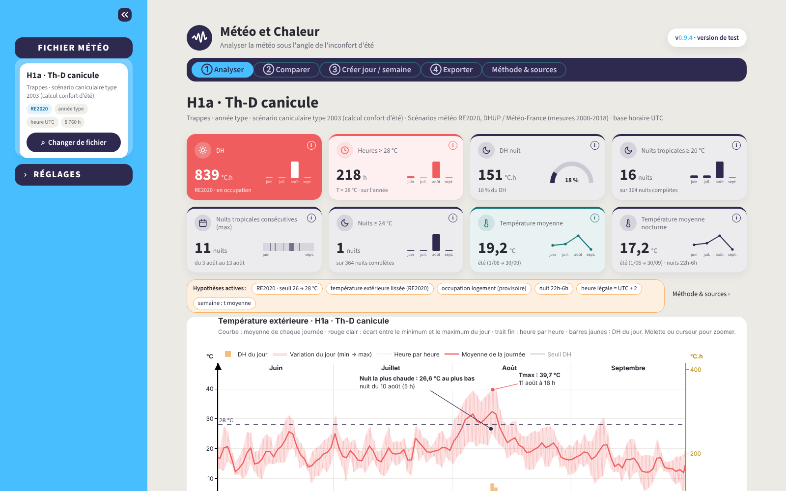
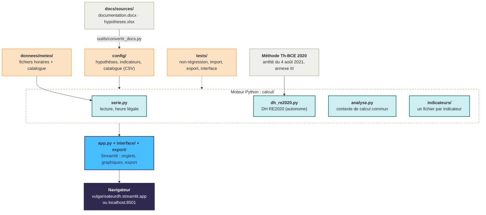

# Météo et Chaleur

Un outil pour lire un fichier météo sous l'angle de l'inconfort d'été : degrés-heures (DH) selon la
méthode RE2020, nuits tropicales, journée et semaine les plus chaudes. Il compare deux fichiers, crée
des journées ou des semaines types, et exporte les résultats.

**Utiliser l'outil en ligne : [vulgarisateurdh.streamlit.app](https://vulgarisateurdh.streamlit.app/)**
(rien à installer). Il se lance aussi sur votre ordinateur (« Installer et lancer en local », partie 2).

> Document non officiel. Les DH sont calculés sur la **température du fichier**, prise comme si c'était
> la température intérieure. L'outil est fait, en base, pour des fichiers de températures extérieures
> (fichiers météo) : c'est alors un indicateur de sévérité du climat, pas le DH d'un bâtiment. Il peut
> aussi s'utiliser avec n'importe quel fichier horaire, y compris des résultats de simulation de
> températures intérieures.
> Version 0.9.15, version de test.



---

# Partie 1 : pour les utilisateurs

## À quoi ça sert

Vous choisissez un fichier météo horaire (8 760 heures). L'outil affiche aussitôt ses indicateurs
d'inconfort d'été, l'année entière heure par heure, puis la semaine et la journée les plus chaudes.
Il sert à comparer des climats : une zone avec une autre, le fichier « moyen » de la RE2020 avec le
fichier « canicule », ou une année type avec un épisode de chaleur réellement mesuré.

Par défaut, tout suit la méthode RE2020 (arrêté du 4 août 2021, annexe III, méthode Th-BCE 2020).

## Comment l'utiliser en quatre étapes

1. **Choisir le fichier météo** : dans le menu de gauche, bouton « Changer de fichier ».
   La fenêtre de choix propose une recherche et les familles de fichiers (RE2020, Observations…) : pour
   chacune, une mini carte de France des zones (clic sur une zone pour filtrer) et les fichiers par zone,
   avec leur DH et leurs nuits ≥ 20 °C.
2. **Lire l'onglet ① Analyser** : dix cartes d'indicateurs, l'année heure par heure (zoom à la
   molette ou avec le curseur ; en bas, une barre bleue par nuit ≥ 20 °C, bleu nuit si ≥ 24 °C), puis la
   semaine et la journée les plus chaudes. La pastille « i » de
   chaque carte donne la définition.
3. **Comparer dans l'onglet ②** : le fichier en cours face à un second fichier (bouton « Changer le
   second fichier »). Tableau des écarts, été superposé, nuits chaudes nuit par nuit, journées et
   semaines les plus chaudes, cumul des DH.
4. **Garder une trace** : voir « Sauvegarder et exporter » ci-dessous.

L'onglet **③ Créer** fabrique une journée ou une semaine type à partir de quelques températures, et
peut l'envoyer dans Comparer. Les **réglages** (seuils RE2020 ou 26/28 °C, DH en occupation ou non,
critères de la journée et de la semaine, lignes horizontales, ordre des cartes) sont repliés en bas
du menu de gauche ; « Revenir au réglage RE2020 » les remet par défaut.

## Les indicateurs

| Indicateur | Ce qu'il compte |
|---|---|
| DH (°C.h) | somme, heure par heure, des degrés au-dessus du seuil d'inconfort |
| Heures > 28 °C | nombre d'heures où la température dépasse 28 °C |
| DH nuit (°C.h) | part des DH tombée la nuit (22 h – 6 h) |
| Nuits tropicales ≥ 20 °C | nuits où la température ne descend pas sous 20 °C |
| Nuits tropicales consécutives | plus longue suite de nuits tropicales |
| Nuits ≥ 24 °C | nuits où la température ne descend pas sous 24 °C |
| Température moyenne | moyenne de l'été (1er juin – 30 septembre) |
| Température moyenne nocturne | moyenne des nuits de l'été |
| Sévérité des vagues de chaleur (°C.j) | somme, sur tous les jours de vague, de l'écart de la température moyenne journalière au seuil de début de la station |
| Vagues de chaleur | nombre de vagues du fichier (méthode Météo-France) |

Les deux indicateurs de vague de chaleur demandent les seuils de la station (`config/seuils_vague_chaleur.csv`,
produit par l'Action « Seuils vagues de chaleur ») : ils existent pour les 8 stations de référence. Les fichiers
RE2020 et TRACC prennent ceux de la station de leur zone, les observations ceux de leur station si elle en fait partie.
Sans station associée (autres observations, fichiers importés), la carte affiche « — ». Un graphique en bas
des onglets Analyser et Comparer montre les vagues du fichier, jour par jour, face aux seuils de sa station.

Le détail de chaque méthode est dans l'onglet **Méthode & sources**.

## Hypothèses à connaître

- **Occupation** : le scénario d'occupation d'un logement est provisoire (CEREMA), il reste à vérifier.
- **Nuits ≥ 24 °C** : seuil proposé, source à préciser.
- **Heure** : les fichiers RE2020 sont en heure UTC ; l'outil les passe en heure légale avec UTC + 2
  toute l'année (heure d'été, celle qui compte pour l'inconfort d'été).
- **Relevés courts** (quelques jours) : le DH RE2020 a besoin d'une année complète ; l'outil calcule
  alors le DH à seuils fixes 26/28 °C et le signale.

## Sauvegarder et exporter

- **Mémoire du navigateur** : le dernier fichier ouvert, les fichiers récents, les lignes horizontales
  et l'ordre des cartes sont gardés dans votre navigateur d'une visite à l'autre. Rien n'est envoyé
  sur un serveur ; en navigation privée, l'outil repart simplement des réglages RE2020.
- **Onglet ④ Exporter** : pour un fichier ou pour les deux fichiers de Comparer,
  - copier-coller des indicateurs, en tableau (Excel, Word) ou en texte (mail) ;
  - fichier CSV prêt pour Excel (séparateur « ; », virgule décimale) ou classeur Excel : indicateurs
    et 8 760 heures (température, seuil, DH), avec le réglage, la version et les sources.

## Importer votre fichier

Fenêtre « Changer de fichier » › « + Importer » : un CSV horaire (5 Mo au plus, 5 fichiers par visite),
séparateur « ; » ou « , », virgule ou point décimal. Trois formes sont reconnues :

| Colonnes | Exemple de ligne | Pour |
|---|---|---|
| `heure;T` | `0;14,2` | une année type de 8 760 ou 8 784 heures |
| `date;heure;T` | `2026-06-01;14:00;31,5` ou `01/06/2026;14:00;31,5` | un relevé, même de quelques jours |
| `horodatage;T` | `01/06/2026 14:00;31,5` | idem |

Les dates `01/06/2026` sont lues au format français (1er juin) et l'outil le signale. Un trou de 3 heures
au plus est comblé ; un fichier mal formé est refusé avec un message qui dit ce qui ne va pas.

## Ce que l'outil ne fait pas encore

- **Proposer un fichier au catalogue** : un fichier importé ne dure que le temps de la session.
- **Version anglaise**.

## Pour en savoir plus

- [Site officiel de la RE2020](https://rt-re-batiment.developpement-durable.gouv.fr/re2020-r320.html)
- [Carte des zones climatiques de la RE2020](https://alliages.github.io/zones-climatiques-re2020/)
- [pythermalcomfort](https://pythermalcomfort.readthedocs.io/) (confort adaptatif, norme EN 16798-1) :
  la référence des tests de l'outil (voir « pythermalcomfort » dans la partie 2)

## Remerciements

Merci à Claude, l'assistant d'Anthropic, pour son aide dans le passage du classeur Excel
« Vulgarisation_DH » à cette application.

---

# Partie 2 : pour les développeurs et les relecteurs

## Comment l'outil est construit



## Installer et lancer en local

Il faut Python 3.10 ou plus récent ([python.org](https://www.python.org/downloads/)).
Ouvrir un terminal dans le dossier du projet, puis :

**Windows (PowerShell ou invite de commandes)**

```
python -m venv .venv
.venv\Scripts\python -m pip install -r requirements.txt
.venv\Scripts\python -m streamlit run app.py
```

Si `python` n'est pas reconnu, remplacer le premier `python` par `py`. Il n'y a pas besoin
d'« activer » l'environnement : les commandes appellent directement le Python de `.venv`. Cet
environnement à part évite les conflits avec Anaconda (notamment l'erreur pyarrow
« DLL load failed »).

**macOS et Linux**

```bash
python3 -m venv .venv
.venv/bin/python -m pip install -r requirements.txt
.venv/bin/python -m streamlit run app.py
```

L'application s'ouvre sur http://localhost:8501. Pour l'arrêter : `Ctrl + C`.

pyarrow ne sert qu'aux tableaux interactifs : s'il ne se charge pas, l'outil le remplace par un
formulaire simple (onglet Créer) et des tableaux fixes.

Variables d'environnement utiles (valeur `1`) :

| Variable | Effet |
|---|---|
| `METEO_DEBUG` | en cas d'erreur, affiche la trace Python complète à l'écran (sinon : une courte référence, la trace restant dans la console) |
| `METEO_SANS_PYARROW` | force le mode sans tableaux interactifs, pour le tester |
| `METEO_SANS_MEMOIRE` | désactive la mémoire du navigateur (tests) |

## Utiliser le moteur sans interface

Le calcul est indépendant de Streamlit et s'utilise directement en Python :

```python
from calcul.serie import charger_catalogue, charger_serie
from calcul.hypotheses import charger_hypotheses
from calcul.analyse import analyser
from calcul.indicateurs import REGISTRE
from config.reglages import REGLAGE_RE2020

hyp = charger_hypotheses()
ligne = charger_catalogue().set_index("id").loc["H1a_th_d"].to_dict() | {"id": "H1a_th_d"}
analyse = analyser(charger_serie(ligne), REGLAGE_RE2020, hyp)
print(round(analyse.dh_h.sum(), 3))                                           # 839.145 °C.h
print(REGISTRE["nuits_20"].calculer(analyse, REGLAGE_RE2020, hyp).valeur)    # 16 nuits ≥ 20 °C
```

`calcul/dh_re2020.py` est autonome (seule dépendance : numpy) et se réutilise dans d'autres projets :
`calculer_dh(temperatures)` donne le DH à seuils fixes, `calculer_dh(t, t_exterieure=t_ext,
occupation="logement_re2020", details=True)` le DH RE2020 détaillé. La méthode est décrite en tête
du fichier, avec les numéros de formule de l'annexe III.

## Ajouter un indicateur

Chaque indicateur est un petit fichier de `calcul/indicateurs/`, découvert automatiquement au démarrage :
rien d'autre à modifier dans l'outil (cartes, tableau de Comparer, export suivent).

1. Copier `calcul/indicateurs/_modele.py` sous le nom de l'identifiant, par exemple `heures_32.py`.
2. Y écrire la fonction `calculer` (et `profil` pour un mini-graphique), puis la déclaration
   `INDICATEUR = Indicateur(id="heures_32", calculer=calculer, teinte="chaud", icone="horloge")`.
   Teintes : `chaud` (rouge), `nuit` (foncé), `moyenne` (bleu canard). Un seuil nouveau va dans
   l'onglet « hypotheses » du classeur et se lit avec `valeur(hyp, "<id>")`, jamais en dur.
3. Ajouter la ligne `heures_32` dans `docs/sources/hypotheses.xlsx`, onglet « indicateurs » : libellé,
   unité, ordre, affiché ou non, bulle « i », décimales. Puis `python outils/convertir_docs.py`.
4. `python -m pytest` : les tests vérifient que chaque fichier a sa ligne dans l'Excel (et inversement),
   et que l'indicateur se calcule.

Le contexte de calcul (`calcul/analyse.py`) donne déjà les températures, seuils et DH heure par heure,
les jours, les nuits et les masques jour / nuit / été : un indicateur tient en général en quelques lignes.

## pythermalcomfort

Depuis la 0.9.8, l'outil **n'installe plus** la librairie [pythermalcomfort](https://pythermalcomfort.readthedocs.io/)
(licence MIT, CBE Berkeley). Elle ne servait qu'à la droite de confort adaptatif (0,33 × température lissée
+ 18,8 + Δ), une formule d'une ligne déjà écrite dans `calcul/confort_ptc.py`, et son chargement (numba,
scipy) retardait d'environ 11 secondes chaque démarrage de l'outil en ligne. Les résultats ne changent pas
(non-régression 839,145 °C.h).

Elle reste la **référence** : `requirements-dev.txt` l'installe et `tests/test_confort_ptc.py` vérifie que la
formule de l'outil donne les mêmes valeurs que la librairie. Partager les indicateurs de l'outil avec la
librairie reste un objectif.

## Organisation du dépôt

```
app.py                  point d'entrée Streamlit : chargement des données (en cache) et aiguillage des onglets
calcul/                 moteur de calcul, sans dépendance à Streamlit
  serie.py              lecture des fichiers (catalogue et imports), heure légale, contrôles
  dh_re2020.py          DH selon l'annexe III (module autonome)
  analyse.py            contexte de calcul commun : DH horaire, jours, nuits, semaine et journée les plus chaudes
  indicateurs/          UN FICHIER PAR INDICATEUR (dh.py, nuits_20.py…), modèle _modele.py, socle base.py
  confort_ptc.py        droite de confort adaptatif (pythermalcomfort en référence des tests)
  hypotheses.py         lecture des hypothèses et des indicateurs
  generateur.py         journées et semaines types (onglet Créer)
  format_fr.py          dates et nombres en français
config/                 reglages.py (version, réglage par défaut, libellés), charte.py (couleurs, dimensions),
                        catalogue des fichiers, CSV générés depuis hypotheses.xlsx
interface/              onglets, menu des réglages, fenêtre de choix, cartes, graphiques (communs / analyse /
                        comparaison), style.css, mémoire du navigateur
export/                 copier-coller, CSV et Excel
docs/sources/           À MODIFIER : documentation.docx (textes) et hypotheses.xlsx (valeurs)
docs/pages/             pages Markdown générées depuis le Word (onglet Méthode & sources)
donnees/meteo/<zone>/   fichiers météo du catalogue (TRACC : donnees/meteo/TRACC/<zone>/)
outils/                 convertir_docs.py, comparaison Excel ↔ Python
tests/                  tests automatiques (lancés aussi par GitHub à chaque envoi : .github/workflows/tests.yml)
CHANGELOG.md            journal des versions
```

## Données et sources

Aucune hypothèse n'est écrite en dur dans le code : les seuils, les heures de nuit, l'été, les
indicateurs (ordre, libellés, décimales) viennent de `docs/sources/hypotheses.xlsx`, et chaque
hypothèse porte sa source et son statut (sourcé, provisoire, à préciser).

- **Fichiers RE2020** : 8 zones × fichier « Th-BC » (climat moyen) et « Th-D » (canicule), scénarios
  météo RE2020, DHUP / Météo-France (mesures 2000-2018), repris de
  [zones-climatiques-re2020](https://github.com/Alliages/zones-climatiques-re2020).
- **Observations** : 20 stations Météo-France, 1er mai – 30 septembre 2026, observations horaires
  (heure UTC), au moins une par zone. Le nom dit où est la station : « (ville) », « (centre-ville) »,
  « (périphérie) », « (aéroport) » ou « (aérodrome) » ; une station d'aéroport sous-estime la chaleur urbaine,
  surtout la nuit. Coordonnées, altitude et emplacement : API Météo-France (synthèse du 03/11/2026). À Trappes, la température du 6/07 7h au 17/07 8h UTC est reconstituée.
- **Fichiers TRACC** (trajectoire de réchauffement de référence) : 8 zones × 3 niveaux (+2, +2,7 et +4 °C),
  avec ou sans vague de chaleur, années types en heure UTC, données climatiques prospectives de
  [data.ademe.fr](https://data.ademe.fr/datasets?q=climatique&topics=fJZXrdcRGP). `outils/convertir_tracc.py`
  les produit depuis le dossier `TRACC/` (non publié). Valeurs non corrigées : 4 fichiers « vague de chaleur »
  dépassent le record français de 46 °C (jusqu'à 54,8 °C à Rennes en +4 °C), ils le disent dans leur description.
- **Catalogue** : `config/catalogue_fichiers.csv` (famille, zone, station, base horaire, source ; facultatif :
  `departement`, `latitude`, `longitude` pour placer la station sur la carte de la fenêtre de choix).
- **Carte des zones** : `config/carte_france.json`, contours des départements et projection repris de
  [zones-climatiques-re2020](https://github.com/Alliages/zones-climatiques-re2020).

Après une modification du Word ou du classeur, régénérer les fichiers puis relancer les tests :

```
python outils/convertir_docs.py
python -m pytest
```

Dans les textes du Word, `[[hyp:identifiant]]` affiche la valeur à jour d'une hypothèse.

## Vérifier le calcul

- **Non-régression** : DH RE2020 du fichier H1a Th-D (Trappes, canicule) = **839,145 °C.h** ; DH à
  seuils fixes 26/28 °C sans occupation = 1 074,935 °C.h.
- **Comparaison Excel ↔ Python** : `outils/construire_excel_dh.py` reconstruit le calcul en formules
  Excel ; `outils/comparer_excel_python.py` compare heure par heure (écart ≤ 10⁻¹⁴).
- **Tests** : 57 tests (méthode DH, indicateurs et leur registre, import de fichiers, fenêtre de choix,
  export, ouverture de chaque onglet, référence pythermalcomfort). GitHub les relance à chaque envoi,
  avec la recherche de failles connues dans les dépendances (pip-audit).

```
python -m pip install -r requirements-dev.txt
python -m pytest
```

**Fichiers à relire en priorité** : `docs/sources/hypotheses.xlsx` (valeurs et sources),
`calcul/dh_re2020.py` (méthode DH) et `calcul/indicateurs/` (un fichier par indicateur).

## Limites connues

- **Occupation** et **seuil de nuit à 24 °C** : hypothèses provisoires (voir Partie 1).
- **Heure légale** : UTC + 2 toute l'année ; l'hiver devrait être en UTC + 1 (sans effet sur les
  indicateurs d'été, visible dans la colonne « heure » de l'export).
- **Années bissextiles** : le 29 février est écarté quand deux fichiers sont mis côte à côte.

## Versions

Versions 0.8.x tant que l'outil ne fonctionnait pas bien, 0.9.x en version de test, puis 1.0.0.
Chiffre pair = évolution importante, chiffre impair = correction. Détail dans `CHANGELOG.md`.

## Licence et crédits

GNU GPL v3 (fichier `LICENSE`). Bibliothèque pythermalcomfort en référence du confort adaptatif ;
fichiers météo RE2020 de la DHUP et de Météo-France ; relevés Infoclimat.

Guillaume Meunier, d'après son classeur Excel « Vulgarisation_DH ».
Code source : [github.com/Alliages/vulgarisateur_DH](https://github.com/Alliages/vulgarisateur_DH).
