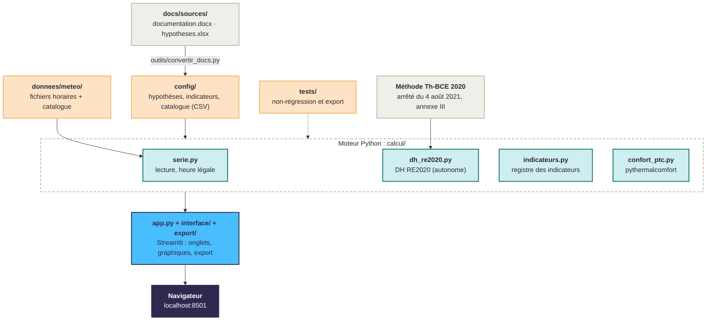

# Météo et Chaleur

Un outil pour lire un fichier météo sous l'angle de l'inconfort d'été : degrés-heures (DH) selon la
méthode RE2020, nuits tropicales, journée et semaine les plus chaudes. Il compare deux fichiers, crée
des journées ou des semaines types, et exporte les résultats.

**Utiliser l'outil : pas encore en ligne.** En attendant, il se lance sur votre ordinateur (voir
« Installer et lancer en local » dans la partie 2).

> Document non officiel. Les DH sont calculés sur la **température extérieure** : c'est un indicateur
> de sévérité du climat, pas le DH d'un bâtiment.
> Version 0.9.5, version de test.


---

# Partie 1 : pour les utilisateurs

## À quoi ça sert

Vous choisissez un fichier météo horaire (8 760 heures). L'outil affiche aussitôt ses indicateurs
d'inconfort d'été, l'année entière heure par heure, puis la semaine et la journée les plus chaudes.
Il sert à comparer des climats : une zone avec une autre, le fichier « moyen » de la RE2020 avec le
fichier « canicule », ou une année type avec un épisode de chaleur réellement mesuré.

Par défaut, tout suit la méthode RE2020 (arrêté du 4 août 2021, annexe III, méthode Th-BCE 2020).

## Comment l'utiliser en quatre étapes

1. **Choisir le fichier météo** : dans le menu de gauche, bouton « Changer de fichier ».
   La fenêtre de choix propose une recherche, les familles de fichiers (RE2020, relevés…), les zones
   placées comme sur la carte de France, puis les fichiers de la zone avec leurs chiffres clés.
2. **Lire l'onglet ① Analyser** : huit cartes d'indicateurs, l'année heure par heure (zoom à la
   molette ou avec le curseur ; les nuits ≥ 20 °C en violet), puis la semaine et la journée les plus
   chaudes. La pastille « i » de
   chaque carte donne la définition.
3. **Comparer dans l'onglet ②** : le fichier en cours face à un second fichier (bouton « Changer le
   second fichier »). Tableau des écarts, été superposé, nuits chaudes nuit par nuit, journées et
   semaines les plus chaudes, cumul des DH.
4. **Garder une trace** : voir « Sauvegarder et exporter » ci-dessous.

L'onglet **③ Créer** fabrique une journée ou une semaine type à partir de quelques températures, et
peut l'envoyer dans Comparer. Les **réglages** (seuils RE2020 ou 26/28 °C, DH en occupation ou non,
critères de la journée et de la semaine, lignes horizontales, ordre des cartes) sont repliés en bas
du menu de gauche ; « Revenir au réglage RE2020 » les remet par défaut.

## Les indicateurs

| Indicateur | Ce qu'il compte |
|---|---|
| DH (°C.h) | somme, heure par heure, des degrés au-dessus du seuil d'inconfort |
| Heures > 28 °C | nombre d'heures où la température dépasse 28 °C |
| DH nuit (°C.h) | part des DH tombée la nuit (22 h – 6 h) |
| Nuits tropicales ≥ 20 °C | nuits où la température ne descend pas sous 20 °C |
| Nuits tropicales consécutives | plus longue suite de nuits tropicales |
| Nuits ≥ 24 °C | nuits où la température ne descend pas sous 24 °C |
| Température moyenne | moyenne de l'été (1er juin – 30 septembre) |
| Température moyenne nocturne | moyenne des nuits de l'été |

Le détail de chaque méthode est dans l'onglet **Méthode & sources**.

## Hypothèses à connaître

- **Occupation** : le scénario d'occupation d'un logement est provisoire (CEREMA), il reste à vérifier.
- **Nuits ≥ 24 °C** : seuil proposé, source à préciser.
- **Heure** : les fichiers RE2020 sont en heure UTC ; l'outil les passe en heure légale avec UTC + 2
  toute l'année (heure d'été, celle qui compte pour l'inconfort d'été).
- **Relevés courts** (quelques jours) : le DH RE2020 a besoin d'une année complète ; l'outil calcule
  alors le DH à seuils fixes 26/28 °C et le signale.

## Sauvegarder et exporter

- **Mémoire du navigateur** : le dernier fichier ouvert, les fichiers récents, les lignes horizontales
  et l'ordre des cartes sont gardés dans votre navigateur d'une visite à l'autre. Rien n'est envoyé
  sur un serveur ; en navigation privée, l'outil repart simplement des réglages RE2020.
- **Onglet ④ Exporter** : pour un fichier ou pour les deux fichiers de Comparer,
  - copier-coller des indicateurs, en tableau (Excel, Word) ou en texte (mail) ;
  - fichier CSV prêt pour Excel (séparateur « ; », virgule décimale) ou classeur Excel : indicateurs
    et 8 760 heures (température, seuil, DH), avec le réglage, la version et les sources.

## Ce que l'outil ne fait pas encore

- **Mise en ligne** : l'outil se lance pour l'instant en local.
- **Fichiers TRACC** (trajectoire de réchauffement de référence) : la famille est prévue, les fichiers
  restent à intégrer.
- **Proposer un fichier au catalogue** : un fichier importé ne dure que le temps de la session.
- **Version anglaise**.

## Pour en savoir plus

- [Site officiel de la RE2020](https://rt-re-batiment.developpement-durable.gouv.fr/re2020-r320.html)
- [Carte des zones climatiques de la RE2020](https://alliages.github.io/zones-climatiques-re2020/)
- [pythermalcomfort](https://pythermalcomfort.readthedocs.io/) (confort adaptatif, norme EN 16798-1)

## Remerciements

Merci à Claude, l'assistant d'Anthropic, pour son aide dans le passage du classeur Excel
« Vulgarisation_DH » à cette application.

---

# Partie 2 : pour les développeurs et les relecteurs

## Comment l'outil est construit



## Installer et lancer en local

Il faut Python 3.10 ou plus récent ([python.org](https://www.python.org/downloads/)).
Ouvrir un terminal dans le dossier du projet, puis :

**Windows (PowerShell ou invite de commandes)**

```
python -m venv .venv
.venv\Scripts\python -m pip install -r requirements.txt
.venv\Scripts\python -m streamlit run app.py
```

Si `python` n'est pas reconnu, remplacer le premier `python` par `py`. Il n'y a pas besoin
d'« activer » l'environnement : les commandes appellent directement le Python de `.venv`. Cet
environnement à part évite les conflits avec Anaconda (notamment l'erreur pyarrow
« DLL load failed »).

**macOS et Linux**

```bash
python3 -m venv .venv
.venv/bin/python -m pip install -r requirements.txt
.venv/bin/python -m streamlit run app.py
```

L'application s'ouvre sur http://localhost:8501. Pour l'arrêter : `Ctrl + C`.

pyarrow ne sert qu'aux tableaux interactifs : s'il ne se charge pas, l'outil le remplace par un
formulaire simple (onglet Créer) et des tableaux fixes. Pour tester ce mode :
variable d'environnement `METEO_SANS_PYARROW=1`.

## Utiliser le moteur sans interface

Le calcul est indépendant de Streamlit et s'utilise directement en Python :

```python
from calcul.serie import charger_catalogue, charger_serie
from calcul.hypotheses import charger_hypotheses
from calcul.indicateurs import analyser
from config.reglages import REGLAGE_RE2020

ligne = charger_catalogue().set_index("id").loc["H1a_th_d"].to_dict() | {"id": "H1a_th_d"}
analyse = analyser(charger_serie(ligne), REGLAGE_RE2020, charger_hypotheses())
print(round(analyse.dh_h.sum(), 3))   # 839.145 °C.h
```

`calcul/dh_re2020.py` est autonome (seule dépendance : numpy) et se réutilise dans d'autres projets :
`calculer_dh(temperatures)` donne le DH à seuils fixes, `calculer_dh(t, t_exterieure=t_ext,
occupation="logement_re2020", details=True)` le DH RE2020 détaillé. La méthode est décrite en tête
du fichier, avec les numéros de formule de l'annexe III.

## Organisation du dépôt

```
app.py                  interface Streamlit (point d'entrée)
calcul/                 moteur de calcul, sans dépendance à Streamlit
  serie.py              lecture des fichiers, heure légale, contrôles
  dh_re2020.py          DH selon l'annexe III (module autonome)
  indicateurs.py        analyse d'une série, registre paramétrique des indicateurs
  confort_ptc.py        seul point de contact avec pythermalcomfort
  hypotheses.py         lecture des hypothèses et des indicateurs
  generateur.py         journées et semaines types (onglet Créer)
config/                 réglages (reglages.py), catalogue des fichiers, CSV générés depuis hypotheses.xlsx
interface/              onglets, fenêtre de choix des fichiers, graphiques Plotly, style, mémoire du navigateur
export/                 copier-coller, CSV et Excel
docs/sources/           À MODIFIER : documentation.docx (textes) et hypotheses.xlsx (valeurs)
docs/pages/             pages Markdown générées depuis le Word (onglet Méthode & sources)
donnees/meteo/<zone>/   fichiers météo du catalogue
outils/                 convertir_docs.py, comparaison Excel ↔ Python
tests/                  tests automatiques
CHANGELOG.md            journal des versions
```

## Données et sources

Aucune hypothèse n'est écrite en dur dans le code : les seuils, les heures de nuit, l'été, les
indicateurs (ordre, libellés, décimales) viennent de `docs/sources/hypotheses.xlsx`, et chaque
hypothèse porte sa source et son statut (sourcé, provisoire, à préciser).

- **Fichiers RE2020** : 8 zones × fichier « Th-BC » (climat moyen) et « Th-D » (canicule), scénarios
  météo RE2020, DHUP / Météo-France (mesures 2000-2018), repris de
  [zones-climatiques-re2020](https://github.com/Alliages/zones-climatiques-re2020).
- **Relevés** : Trappes et Paris-Montsouris, épisode de chaleur de mai 2026, Infoclimat (repris de
  l'Excel Vulgarisation_DH).
- **Catalogue** : `config/catalogue_fichiers.csv` (famille, zone, station, base horaire, source).

Après une modification du Word ou du classeur, régénérer les fichiers puis relancer les tests :

```
python outils/convertir_docs.py
python -m pytest
```

Dans les textes du Word, `[[hyp:identifiant]]` affiche la valeur à jour d'une hypothèse.

## Vérifier le calcul

- **Non-régression** : DH RE2020 du fichier H1a Th-D (Trappes, canicule) = **839,145 °C.h** ; DH à
  seuils fixes 26/28 °C sans occupation = 1 074,935 °C.h.
- **Comparaison Excel ↔ Python** : `outils/construire_excel_dh.py` reconstruit le calcul en formules
  Excel ; `outils/comparer_excel_python.py` compare heure par heure (écart ≤ 10⁻¹⁴).
- **Tests** : 33 tests (méthode DH, indicateurs, fenêtre de choix des fichiers, export).

```
python -m pip install pytest
python -m pytest
```

**Fichiers à relire en priorité** : `docs/sources/hypotheses.xlsx` (valeurs et sources),
`calcul/dh_re2020.py` (méthode DH) et `calcul/indicateurs.py` (définition des indicateurs).

## Limites connues

- **Occupation** et **seuil de nuit à 24 °C** : hypothèses provisoires (voir Partie 1).
- **Heure légale** : UTC + 2 toute l'année ; l'hiver devrait être en UTC + 1 (sans effet sur les
  indicateurs d'été, visible dans la colonne « heure » de l'export).
- **Années bissextiles** : le 29 février est écarté quand deux fichiers sont mis côte à côte.

## Versions

Versions 0.8.x tant que l'outil ne fonctionnait pas bien, 0.9.x en version de test, puis 1.0.0.
Chiffre pair = évolution importante, chiffre impair = correction. Détail dans `CHANGELOG.md`.

## Licence et crédits

GNU GPL v3 (fichier `LICENSE`). Bibliothèque pythermalcomfort pour le confort adaptatif ; fichiers
météo RE2020 de la DHUP et de Météo-France ; relevés Infoclimat.

Guillaume Meunier, d'après son classeur Excel « Vulgarisation_DH ».
Code source : [github.com/Alliages/vulgarisateur_DH](https://github.com/Alliages/vulgarisateur_DH).
